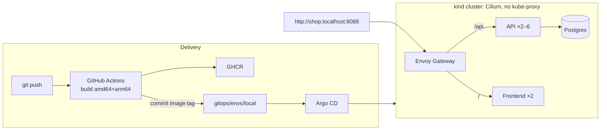

# k8s-local-lab

A production-style Kubernetes platform on a laptop: a small shop (React frontend, NestJS API,
Postgres) on a 3-node [kind](https://kind.sigs.k8s.io/) cluster, delivered with GitOps.
A `git push` builds the images, publishes them, and deploys them, with zero downtime.



## What it demonstrates

- **Hardened workloads:** restricted Pod Security, non-root distroless/unprivileged images
  pinned by digest, read-only filesystems, liveness vs readiness done right, graceful shutdown.
- **Zero-downtime operations:** `maxUnavailable: 0` rollouts, HPA, PodDisruptionBudgets,
  topology spread; verified under load with failure drills.
- **Networking:** Cilium (eBPF, kube-proxy replacement), default-deny NetworkPolicies, Hubble,
  Gateway API with Envoy Gateway.
- **GitOps:** Argo CD App of Apps, sync waves, AppProjects, automated sync with prune and
  self-heal; rollback is `git revert`.
- **CI/CD:** one reusable GitHub Actions workflow, multi-arch images tagged by commit,
  deploy through a Git commit.
- **Operations:** runbooks, an architecture decision record, and written-up failure drills,
  including the ones where the first diagnosis was wrong.

## Quickstart

Needs Docker (8 GB of memory), `kind`, `kubectl`, `helm`, `cilium` and `git`
(versions in [cluster/README.md](cluster/README.md)).

```bash
make bootstrap        # ~10 min: cluster, Cilium, Argo CD; Argo CD deploys everything else
make smoke            # site + API through the gateway
```

Then open **http://shop.localhost:8088** (Chrome or Firefox; Safari needs
`127.0.0.1 shop.localhost` in `/etc/hosts`). `make` lists all shortcuts.

## Changing things

| Change | What happens after `git push` |
|---|---|
| Code in `services/api/` or `services/frontend/` | CI builds and publishes the image, commits its tag, Argo CD rolls it out |
| Settings in `gitops/envs/local/shop.yaml`, the chart, or `gitops/` | Argo CD applies it (within ~3 min, or `argocd app get <app> --refresh`) |
| A bad change | `git revert` it and push: see [docs/runbooks/rollback.md](docs/runbooks/rollback.md) |

CI adds commits to `main`: `git pull` before you push.

## Repository map

```
services/
  api/                NestJS API (health, readiness, metrics, graceful shutdown)
  frontend/           React + Vite, served by nginx
charts/shop/          Helm chart for the app (defaults only)
gitops/
  root.yaml           App of Apps, the only Argo CD object applied by hand
  apps/               one Argo CD Application per component, plus AppProjects
  platform/           namespace (Pod Security) and GatewayClass/EnvoyProxy
  envs/<env>/         per-environment settings; CI writes image tags here
  argocd/             Argo CD's own Helm values
cluster/              kind config and bootstrap script
.github/workflows/    reusable build-and-deploy + one caller per service
docs/
  architecture.md     how it fits together
  runbooks/           symptom → cause → fix
  decisions/          architecture decision records
  lab/                phase plans and failure-drill write-ups
```

## Documentation

- [Architecture](docs/architecture.md)
- [Runbooks](docs/runbooks/README.md)
- [Decisions](docs/decisions/)
- Failure drills: [Phase 2](docs/lab/phase-2-drills.md) (workloads), [Phase 3](docs/lab/phase-3-drills.md) (GitOps)

## Roadmap

- [x] Phase 2: Kubernetes core on kind
- [x] Phase 3: GitOps with Argo CD, CI-built images
- [ ] Observability: Prometheus, Grafana, logs, alerts, SLOs
- [ ] CI quality gates: tests, image scanning and signing, pull-request checks
- [ ] Secrets from a secret manager (External Secrets), TLS
- [ ] EKS with Terraform

## License

[MIT](LICENSE)
