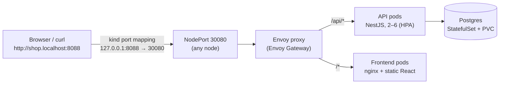
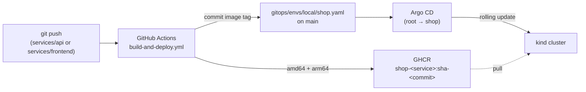

# Architecture

A small shop (React frontend, NestJS API, Postgres) on a 3-node kind cluster, run the way
you'd run it in production: hardened workloads, default-deny networking, GitOps with
Argo CD, and images built and deployed by CI.

## Request path

- **One hostname** for page and API: the HTTPRoute sends `/api/*` to the API and everything
  else to the frontend (longest prefix wins), so the browser needs no CORS.
- **`shop.localhost`**: names ending in `.localhost` always mean this machine (no `/etc/hosts`
  for curl, Chrome, Firefox). `.local` was dropped: macOS sends it to Bonjour first (5 s lookups).
- **NodePort with `externalTrafficPolicy: Cluster`**: the port mapping always lands on the
  control-plane, which never runs Envoy; `Local` (Envoy Gateway's default) dropped that traffic.
  See [decision 0001](decisions/0001-cilium-kube-proxy-replacement.md).

## Delivery path

- **Git is the only way to change what runs.** Argo CD syncs automatically, prunes objects
  removed from Git, and self-heals manual changes to fields that are in Git.
- **Rollback is `git revert`.** Every deploy is a commit (a code commit, then CI's tag commit).
- **Images are tagged with the commit** (`sha-<7>`), never reused. `GET /api/version` and the
  page footer show which commits are running.
- Changes to `charts/` or `gitops/` don't build anything: Argo CD applies them directly.

## What runs where

| Layer | Component | Managed by |
|---|---|---|
| Cluster | kind 3 nodes, Kubernetes 1.36.4 (no kube-proxy) | `cluster/bootstrap.sh` |
| Networking | Cilium 1.20.5 (CNI, NetworkPolicies, Services via eBPF), Hubble | `cluster/bootstrap.sh` |
| GitOps | Argo CD 3.6.2, root App of Apps | `cluster/bootstrap.sh` + `gitops/argocd/values.yaml` |
| Add-ons | metrics-server, Envoy Gateway | Argo CD (`gitops/apps/`, project `platform`) |
| Platform | `shop` namespace (restricted Pod Security), GatewayClass + EnvoyProxy | Argo CD (`gitops/platform/`) |
| App | API, frontend, Postgres, Gateway/HTTPRoute, HPA, PDBs, NetworkPolicies, RBAC | Argo CD (`charts/shop` + `gitops/envs/local/shop.yaml`, project `shop`) |
| Secrets | `postgres-credentials` | created once by bootstrap (External Secrets later) |

Sync waves order a fresh install: projects (−1) → metrics-server, Envoy Gateway (0) →
platform (1) → shop (2).

## Security layers

| Layer | What it enforces |
|---|---|
| Pod Security Admission | `restricted` in `shop`: non-root, no privilege escalation, all capabilities dropped, seccomp |
| Containers | read-only root filesystems, numeric non-root users, no service account tokens, distroless/unprivileged images pinned by digest |
| NetworkPolicies | default-deny ingress; only Envoy → API/frontend, only API → Postgres |
| Kubernetes RBAC | read-only `developer` role (no Secrets, no exec) |
| Argo CD | AppProjects limit repos, namespaces and cluster-scoped kinds; `dev` account is read-only |
| CI | least-privilege token per job, actions pinned by SHA |

## Resilience

- Liveness never checks the database; readiness does (a DB outage takes pods out of rotation
  without restarting them).
- Graceful shutdown: readiness fails on SIGTERM, a delay lets the gateway stop routing, then
  in-flight requests finish (API); a `preStop` sleep does the same for nginx.
- `maxUnavailable: 0` rollouts, topology spread across nodes, PodDisruptionBudgets.
- Verified by failure drills: [Phase 2](lab/phase-2-drills.md), [Phase 3](lab/phase-3-drills.md).

## Known limits

- No observability stack yet (metrics are exposed at `/metrics`, nothing collects them).
- CI has no tests or image scanning; every push to `main` deploys.
- Single environment; Postgres is a single pod without backups.
- Plain HTTP only.
